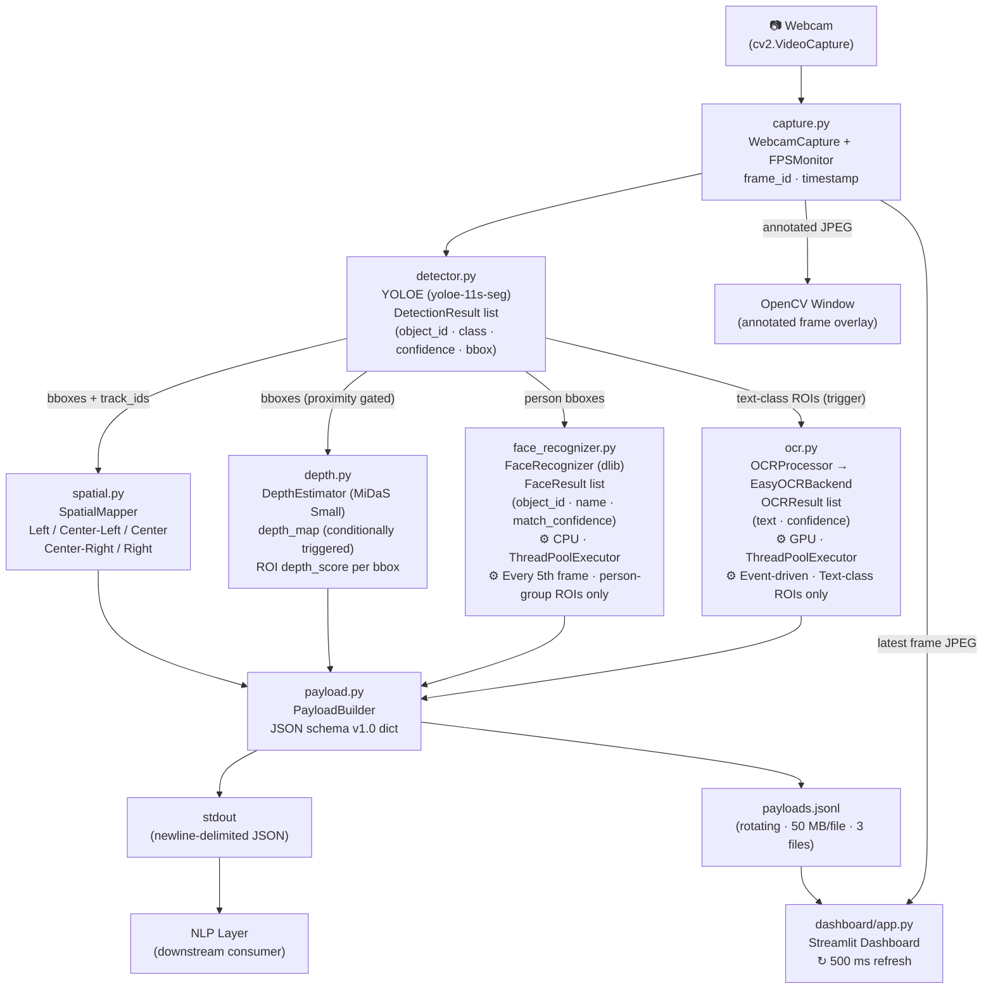

# Architecture: Gesto-Drive CV Pipeline

## 1. System Purpose

The CV pipeline is the **perception layer** of the Gesto-Drive system. It follows a strict separation of concerns:

- **CV layer (this repo):** "dumb sensor" — observes, detects, measures, identifies, reads text. Emits structured data.
- **NLP layer (downstream):** semantic reasoner — interprets the CV payload to understand intent, context, and danger.

The CV layer never makes decisions. It never says "turn left" or "this is dangerous." It says "there is a person in the Center at depth 0.74, and her name is Alice."

---

## 2. Full Data-Flow Diagram



---

## 3. Module Responsibilities

### `config.py` — Single Source of Truth
Holds a `PipelineConfig` dataclass with every tuneable parameter. No magic numbers anywhere in the codebase — all constants are defined here.

### `vocabulary.py` — Labels & Semantic Gates
- Defines `OUTDOOR_LABELS` and `INDOOR_LABELS` for YOLOE prompt embeddings.
- Defines subsets: `HAZARD_CLASSES`, `AGENT_CLASSES`, `OCR_TRIGGER_CLASSES` for conditional module triggering.
- Defines `PRIORITY_CLASSES` for mapping detections to NLP action hints (`"critical"`, `"standard"`, `"contextual"`).

### `capture.py` — Webcam I/O & FPS Monitoring
- `WebcamCapture`: wraps `cv2.VideoCapture`, sets resolution, auto-increments `frame_id`, attaches `timestamp`
- `FPSMonitor`: rolling 30-frame window average; exposes `current_fps` and `is_degraded(target)`
- Context-manager aware — guarantees `cap.release()` on exit

### `detector.py` — Object Detection & Tracking
- Loads `yoloe-11s-seg.pt` (open-vocabulary detector); runs on CUDA.
- Calls `model.set_classes(vocabulary)` dynamically based on scene mode (Indoor/Outdoor).
- Calls `model.track(frame, persist=True, tracker="bytetrack.yaml")` — ByteTrack assigns `track_id` continuously.
- Returns `List[DetectionResult(object_id, class_name, confidence, bbox_xyxy)]`
- Handles ByteTrack warm-up frames where `track_id` may be `None`.

### `depth.py` — Monocular Depth Estimation
- Loads `MiDaS_small` via `torch.hub` with local cache path (`TORCH_HOME`).
- **Conditionally Triggered:** Evaluates depth only when YOLO detects a hazard or dynamic agent taking up a significant area of the frame (proximity gate), or on a fallback interval (every 6th frame).
- `get_roi_depth(depth_map, bbox)` → median depth in ROI, normalized to 0.0–1.0 (1.0 = closest)
- MiDaS inverse-depth convention: higher raw value = closer to camera

### `face_recognizer.py` — Face Identity
- `FaceDB`: load/save face encodings to `data/known_faces.pkl` with atomic write
- `FaceRecognizer`:
  - **YOLO-gated:** skipped entirely when no `"person"` detected → zero CPU cost on person-free frames
  - **Frame-skip:** every `face_every_n_frames` (default: 5)
  - **ROI-crop + 50% resize** before dlib encoding (same trick as `old-temp/`)
  - Returns `FaceResult(object_id, name, match_confidence)` cross-linked to YOLO detection
- Runs in `ThreadPoolExecutor` — CPU-bound dlib does not block the CUDA pipeline

### `ocr.py` — Optical Character Recognition
- `OCRBackend` abstract base class → swappable: `EasyOCRBackend` (primary), `PaddleOCRBackend` / `TesseractBackend` stubs
- `EasyOCRBackend`: `easyocr.Reader(['en'], gpu=True)` — CUDA-accelerated
- `OCRProcessor`:
  - **Event-Driven ROI-trigger:** Fires purely when YOLOE detects text-relevant labels (`stop sign`, `traffic light`, `wet floor sign`, etc.). OCR compute is zero when these objects are absent.
  - Results filtered by `ocr_conf_thresh` (default: 0.7) — low-confidence results dropped
- Runs in `ThreadPoolExecutor` — does not block main loop

### `spatial.py` — Bounding Box → Zone
- Divides frame width into `n_zones` equal bins (default: 5)
- Uses **bbox center-x** as anchor (not left edge) to correctly classify wide objects
- Zone labels: `["Left", "Center-Left", "Center", "Center-Right", "Right"]`
- Fully parametric — adding a 7-zone config requires zero code change

### `payload.py` — JSON Schema Builder & Emitter
- `PayloadBuilder.build(...)` → `dict` conforming to schema v1.0. Appends `priority` semantic tags to detections.
- `emit(payload)` → dual-write: stdout (newline-delimited) + rotating `.jsonl` file
- File rotation: 50 MB per file, last 3 files retained (prevents disk fill on long runs)

### `pipeline.py` — Main Orchestration Loop
Central coordinator. Wires all modules together, manages frame interleaving, monitors FPS, handles graceful degradation, and exposes the annotated frame to the OpenCV window and Streamlit shared state.

---

## 4. Threading Model

```
Main Thread (CUDA)                     Worker Threads (CPU)
──────────────────                     ────────────────────
capture.py                             face_recognizer.py
detector.py  (GPU)                      └─ ThreadPoolExecutor
depth.py     (GPU)                     ocr.py
spatial.py                              └─ ThreadPoolExecutor
payload.py
pipeline.py (orchestration)
```

- Face recognition and OCR submit to a shared `ThreadPoolExecutor(max_workers=2)`
- Results are retrieved via `Future.result(timeout=...)` before payload assembly
- If a worker hasn't finished by the assembly step, the previous cached result is used and `"errors"` is populated

---

## 5. Degraded-State Strategy

| Trigger | Action |
|---|---|
| FPS < `fps_target` for 5 consecutive frames | `depth_fallback_interval` → +2, OCR interval → 20; `status` → `"degraded"` |
| `torch.cuda.OutOfMemoryError` | Flush VRAM (`torch.cuda.empty_cache()`), fall back to CPU for that frame, log to `"errors"` |
| Webcam read failure | Retry 3× then emit `status: "error"` and exit cleanly |
| `Ctrl+C` or `q` key | Emit final payload with `status: "shutdown"`, release camera, join thread pool |

---

## 6. WebSocket Upgrade Path (Future)

v1 uses stdout + JSONL file as transport. The `PayloadEmitter` is designed with a sink abstraction:
- `"stdout"` → current default
- `"file"` → rolling JSONL
- `"both"` → dual write (current default)
- `"websocket"` → **future** — add a `WebSocketEmitter` that pushes to an async WS server; the NLP layer subscribes. No changes to `PayloadBuilder` or any upstream module required.
